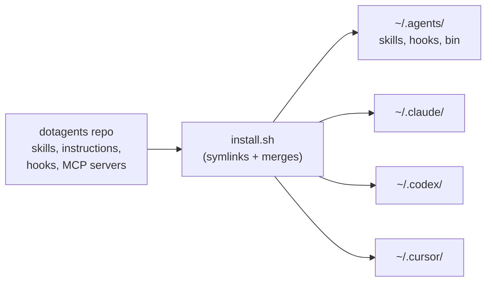

# dotagents

My personal AI setup, written once and shared by every AI coding tool I use: Claude Code, Codex and Cursor.

Each tool keeps its own instructions, skills, MCP servers and hooks in its own folder, in its own format. Keeping them in sync by hand means they drift, and switching tools or machines means starting over. This repo is the single source of truth. `install.sh` links it into each tool's config, so editing a file here changes every tool at once.



Terms like Setting, Lesson and Level have a precise meaning here: see [GLOSSARY.md](GLOSSARY.md).

## What's included

### Instructions

[`global/AGENTS.md`](global/AGENTS.md) holds my personal instructions for every project. It's linked as `~/.claude/CLAUDE.md` and `~/.codex/AGENTS.md`.

### Skills

A **skill** is a `SKILL.md` file that teaches an agent one workflow. Skills are tool-neutral: each says *what* to do, never which tool does it. They live in [`skills/`](skills/). Steps several skills share are in [`skills/_shared/conventions.md`](skills/_shared/conventions.md).

**Pull requests**

| Skill | What it does |
|---|---|
| [`address-review`](skills/address-review/SKILL.md) | Work through a PR's open review threads: fix what holds up, reply to the rest |
| [`fix-pr`](skills/fix-pr/SKILL.md) | Make one PR's failing checks pass and push |
| [`renovate-prs`](skills/renovate-prs/SKILL.md) | Fix, verify and merge open Renovate PRs, one subagent per PR |
| [`review-pr`](skills/review-pr/SKILL.md) | First-pass PR review by fresh subagents, posted as a comment-only review |
| [`ship-pr`](skills/ship-pr/SKILL.md) | Take the current changes to a merged PR, by the repo's own rules |

**Epics**

| Skill | What it does |
|---|---|
| [`build-epic`](skills/build-epic/SKILL.md) | Build an epic from the tracker into one reviewed PR per ticket, using planner, explorer and implementer subagents |
| [`to-epic`](skills/to-epic/SKILL.md) | Turn meeting notes, docs or any source into an epic and its issues on the tracker |

**Code health**

| Skill | What it does |
|---|---|
| [`security-audit`](skills/security-audit/SKILL.md) | Security-audit a repo of any size with subagents, then fix the findings you pick |
| [`tune-tests`](skills/tune-tests/SKILL.md) | Make the tests faster and their coverage wider in one PR |

**The setup itself**

| Skill | What it does |
|---|---|
| [`add-plugin`](skills/add-plugin/SKILL.md) | Add a Claude Code plugin after showing what it adds and costs |
| [`configure`](skills/configure/SKILL.md) | Show or change the Settings skills read, for this machine or this repo |
| [`remember`](skills/remember/SKILL.md) | After a skill run, save what it learned about the repo for next time |
| [`telemetry`](skills/telemetry/SKILL.md) | Show what a run cost per skill, compare runs over time, and find wasted steps |

### Subagents

Some skills start **subagents**: focused helpers, each with a fresh context. Each one's instructions are a portable brief beside its skill. `adapters/<tool>/agents/` holds thin wrappers for Claude Code, Codex and Cursor that point at that brief.

| Subagent | Started by | Job |
|---|---|---|
| `epic-planner` | `build-epic` | Writes the spec, tickets and tasks |
| `epic-explorer` | `build-epic` | Explores one area of the repo and writes a cited note |
| `epic-implementer` | `build-epic` | Builds one task test-first in its own worktree |
| `source-reader` | `to-epic` | Reads one source and notes its needs, decisions and open questions |
| `pr-fixer` | `fix-pr`, `renovate-prs` | Takes one PR's failing checks to green |
| `pr-reviewer` | `review-pr` | Finds bugs, rule breaks and missing tests in one PR |
| `security-mapper` | `security-audit` | Maps the attack surface into areas and flows |
| `security-reviewer` | `security-audit`, `review-pr` | Hunts security issues in one PR, area or flow |
| `test-tuner` | `tune-tests`, `build-epic` | Makes tests faster and widens coverage |

Subagents can also run on a remote machine (a Kubernetes cluster, Docker or an SSH host) for compute only: the sandbox gets a snapshot of one worktree and sends back a patch, and never touches GitHub. Overview with diagrams: [docs/remote.md](docs/remote.md). Full reference: [remote/README.md](remote/README.md).

### Hooks

**Hooks** are scripts the tool runs before or after an action. Their logic lives in [`scripts/hooks/`](scripts/hooks/), and each tool's adapter wires them up. Details: [docs/hooks.md](docs/hooks.md).

| Hook | What it does | Tools |
|---|---|---|
| `guard-merge` | Blocks `gh pr merge`, PR approvals and pushes to main in repos with a merge gate | Claude, Codex, Cursor |
| `guard-secrets` | Blocks reading secret files and committing secrets | Claude, Codex, Cursor |
| `allow-task-cleanup` | Approves deleting finished branches and worktrees without asking | Claude |
| `telemetry-save` | Saves each session's cost and steps when it ends | Claude |

### MCP servers

[`mcp/servers.json`](mcp/servers.json) is one list of MCP servers, installed into Claude Code, Codex and Cursor. Credentials are `${ENV_VAR}` references, with the values kept in `~/.config/dotagents/mcp.env`, which is never committed.

| Server | What it gives |
|---|---|
| `context7` | Up-to-date library and framework docs |
| `playwright` | A browser the agent can drive |

### Claude Code extras

- **Plugins** ([`adapters/claude/plugins.txt`](adapters/claude/plugins.txt)): `mattpocock-skills`, a set of engineering skills (grilling, TDD, code review, ...).
- **Mods** ([`adapters/claude/mods/`](adapters/claude/mods/)): `remote-runs` adds a `/remote-runs` pane listing remote subagent runs and their live logs.
- **Guardrails** ([`adapters/claude/settings/`](adapters/claude/settings/)): deny `gh pr review` and `gh auth token`, so an agent can't approve PRs or borrow my GitHub login. Codex gets the same rule in [`adapters/codex/rules/`](adapters/codex/rules/).

## Install

Needs `bash`, `git` and `jq`. The `claude` CLI is needed for plugins and MCP servers. `python3` is needed for `telemetry`, and `gh` for the PR skills.

```sh
git clone git@github.com:rpvsilva/dotagents.git ~/Desktop/Projects/dotagents
~/Desktop/Projects/dotagents/install.sh          # or one tool: install.sh claude|codex|cursor
```

- Everything is symlinked, so editing the repo updates every tool at once.
- Re-run `install.sh` after adding a skill or moving the repo. Running it twice is safe.
- Anything it replaces is moved to `~/.dotagents-backup/` first.
- Codex and Cursor are skipped when `~/.codex` or `~/.cursor` doesn't exist.

What gets linked where: [docs/how-it-works.md](docs/how-it-works.md).

## Use

Start any supported tool and call a skill by name, e.g. `/ship-pr` in Claude Code, or ask for it in plain words. Hooks and MCP servers work without any action from you.

To change how a skill behaves (how many subagents run at once, which tracker holds tickets), use the `configure` skill. See [docs/settings.md](docs/settings.md).

## Layout

```
README.md           this file
AGENTS.md           how to work on this repo (CLAUDE.md links to it)
GLOSSARY.md         the repo's terms
global/AGENTS.md    my global instructions, linked into every tool
skills/             tool-neutral skills; skills/_shared/ holds what they share
mcp/servers.json    MCP servers for every tool
scripts/hooks/      hook logic as plain scripts
scripts/            install helpers, settings, remote-agent, merge-pr
adapters/<tool>/    tool-only pieces: agent wrappers, hook wiring, rules
remote/             remote subagents
docs/               how it works, settings, hooks, remote subagents
tests/              the checks CI runs (tests/run.sh)
```

## Contributing

Read [AGENTS.md](AGENTS.md) first. It covers:
- the principles
- how to add a skill, subagent, tool, hook, plugin, mod or MCP server
- the checks (`tests/run.sh`)
- the PR rules: PRs merge only through `scripts/merge-pr.sh` and the `agent-pr-gate`
