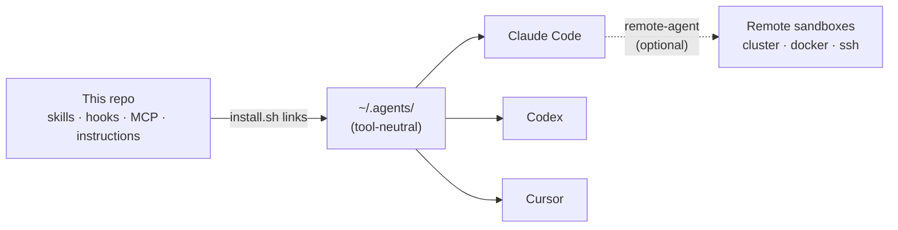

# 📚 The docs

[← Back to the main README](../README.md)

Welcome! dotagents is one setup for every AI coding tool. You write your instructions, skills, hooks and MCP servers once, and Claude Code, Codex and Cursor all pick them up.

These pages explain how it all works. You don't need to read them in order. Find what you want to do below and jump in.

## 🧭 Start here

| You want to... | Read |
|---|---|
| See what `install.sh` actually does to your machine | 🔧 [How it works](how-it-works.md) |
| Change how a skill behaves (fewer agents, another tracker) | 🎛️ [Settings](settings.md) |
| Find out why your agent was just blocked (or wasn't asked) | 🪝 [Hooks](hooks.md) |
| Run subagents on a Kubernetes cluster, Docker or another machine | ☁️ [Remote subagents](remote.md) |
| Fork this repo without shipping someone else's values | 👤 [Personal values](personal.md) |

## 🤔 The "why" pages

Short pages on a decision and what led to it.

| Question | Read |
|---|---|
| Why don't subagents chat with each other? | 💬 [Agent communication](agent-communication.md) |
| Isn't this what Claude's self-hosted environments or Cowork do? | ⚖️ [Compared with Claude features](claude-features.md) |
| Why start `build-epic` through its own launcher? | 🚀 [build-epic launcher](build-epic-launcher.md) |

## 🛠️ For people working on this repo

| Topic | Read |
|---|---|
| Measuring whether a skill change made things better or worse | 🧪 [Evals](evals.md) |
| Could APM replace `install.sh`? (The study and the decision) | 🧭 [APM study](apm.md) |
| Which pins Renovate bumps, and which are bumped by hand | 📌 [Dependencies](dependencies.md) |
| How the repo went public | 🌍 [Going public](going-public.md) |

Also worth knowing:
- [GLOSSARY.md](../GLOSSARY.md) defines every capitalised term the docs use: Part, Group, Setting, Level, Lesson...
- [CONTRIBUTING.md](../CONTRIBUTING.md) covers opening your first PR.
- [AGENTS.md](../AGENTS.md) holds the rules an agent follows when it works on this repo.

## 🗺️ The big picture in one diagram

One source of truth, linked everywhere. Edit a skill in the repo and every tool sees the change at once.
