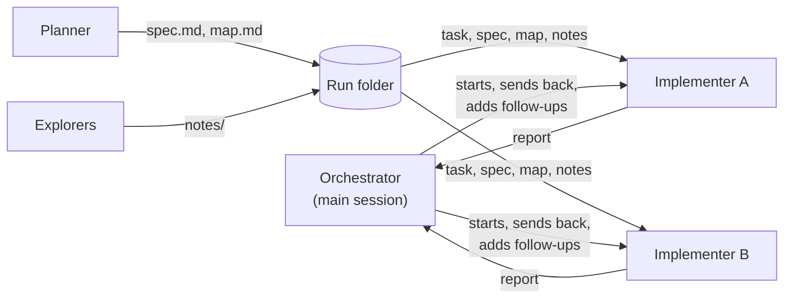

# 💬 Agent communication

[← Back to README](../README.md)

**Decision:** subagents don't talk to each other. Every message goes through the orchestrator (hub-and-spoke). This page explains why. How the setup compares with Claude's self-hosted environments and Cowork is in [claude-features.md](claude-features.md).

## How agents share work today

- **Files carry the work.** The planner writes `spec.md` and `map.md`, explorers write `notes/`, and implementers read them.
- **Reports go up.** Each subagent ends with a short report (`status`, `why`, `follow-up`). The orchestrator acts on it alone.
- **The orchestrator passes things on.** A `follow-up` becomes an acceptance criterion on a later task. A failed check or a merge conflict is sent back to the implementer. `plan-wrong` triggers a re-plan, which you approve.
- **Remote subagents are cut off on purpose.** They get a snapshot plus attached files and send back only a patch and their output object, as their final message ([remote.md](remote.md)).

## Why not let agents talk directly

What it would give us:

| Advantage | What it means |
|---|---|
| Faster fixes to shared problems | Implementer A warns B about a broken helper straight away |
| Less rework | Two agents agree on an interface before both write code |
| Questions mid-task | An implementer asks instead of guessing or stopping as `plan-wrong` |
| A thinner orchestrator | Small coordination skips the main session's context |
| Better parallel work | Agents split or hand off work themselves |

What it would cost:

| Cost | Why it matters here |
|---|---|
| No paper trail | Decisions hide in messages; today every one is in a file or report |
| Runs can't resume cleanly | `build-epic` resumes from the run folder; live chat is gone when the session ends |
| A weaker trust boundary | A prompt-injected remote agent could steer others, including local ones with GitHub access. Today only a patch comes back |
| Less portable | Messaging between agents depends on the tool, so we'd keep two ways of working |
| Harder to run remotely | Sandboxes would need a live channel in or out: more code, more attack surface |
| More tokens and time | Agents chat, loop or wait on each other |
| Agents agree on the wrong thing | Plan changes skip the planner and your approval |
| Less predictable runs | Who talks when depends on timing, so the same epic plays out differently |
| Hidden dependencies | Tasks are planned to be independent; chat couples them, so one stuck agent stalls another |

The costs hit what this setup is built on: traceability, resumable runs, the remote trust boundary and **portable first**. The gains are small, because the planner already splits tasks to be independent and `follow-up` and `plan-wrong` cover the main cases.

## When to look at it again

When implementers often end as `plan-wrong` or `blocked` over questions a quick answer would have settled. The [telemetry](../skills/telemetry/SKILL.md) skill can show how often that happens.

Even then, don't add direct chat. Add a file-based **questions** channel: the implementer writes a question to the run folder, and the orchestrator answers it or routes it. It keeps the paper trail and works in every tool. Its limits: the agent waits or goes on with a guess, the orchestrator has more to watch, and remote agents can't use it mid-run.
