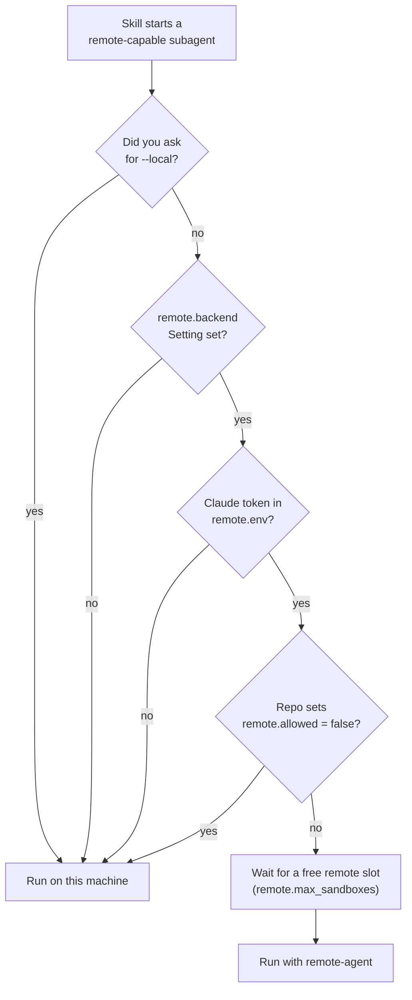
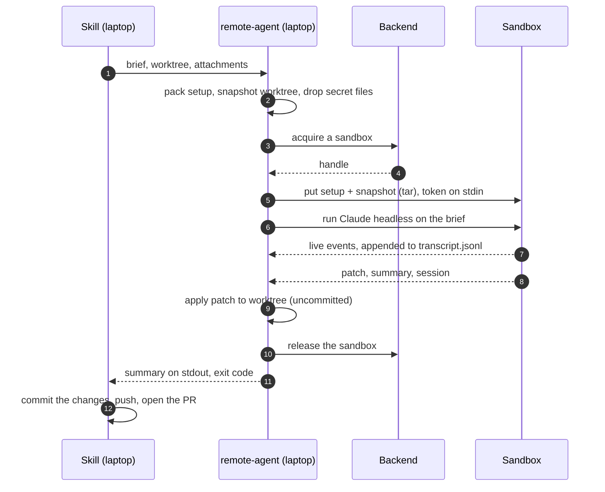
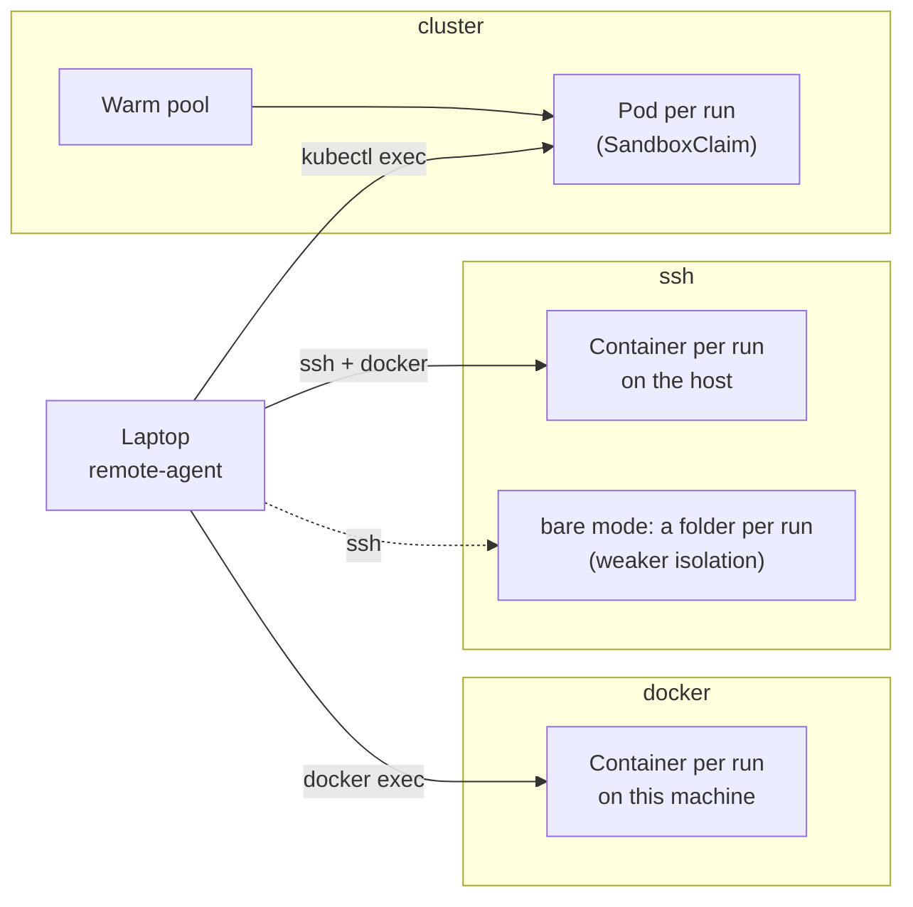
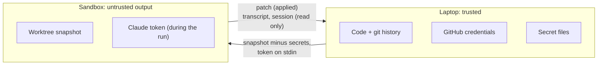

# ☁️ Remote subagents

[← Back to README](../README.md)

A skill can run some of its subagents on another machine instead of your laptop: a Kubernetes cluster, Docker on this machine, or a VM or PC over SSH. The remote machine is **compute only**. It gets your setup and a snapshot of one worktree, runs Claude headless on one task, and sends back a patch. Your laptop keeps the code, the git history, GitHub access and the orchestrating session.

Why use it: a skill like `build-epic` can run many implementers at once without overloading your laptop. Since the sandbox never touches GitHub, this works for any project, even ones the remote machine's owners can't access.

This page is the overview. Every flag, file and backend detail is in [remote/README.md](../remote/README.md).

## When a subagent runs remotely

Only subagents a skill marks **remote-capable** can run remotely: ones that only change their own worktree. Today that's `build-epic`'s implementer. Before each one starts, the skill runs `remote-agent ready` in the repo:



When remote runs are off, the skill says why once, then runs subagents locally as usual. Every other subagent (planners, reviewers, anything that needs GitHub) always runs locally.

## What one run does



1. **Pack.** `remote-agent` stages your setup: `CLAUDE.md`, skills, agents, the hooks under `~/.agents/hooks`, and a cut-down `settings.json`. It snapshots the worktree's tracked and unignored files, leaving out secret-looking ones with the same rule as the `guard-secrets` hook. Credentials, history and caches never leave the laptop.
2. **Acquire and send.** The backend gives a fresh sandbox. The setup and snapshot go in as tar streams, and the Claude token goes through stdin, never as an argument.
3. **Run.** The sandbox reinstalls plugins and MCP servers, commits the snapshot as a base, and runs Claude on the brief. Events stream back as they happen.
4. **Return.** The patch is applied to your worktree, uncommitted. The skill reviews and commits it like a local subagent's work.
5. **Release.** The sandbox is removed on exit, Ctrl-C or `kill`. If the laptop dies first, it removes itself after `remote.hours` (2 by default).

Exit codes: `0` applied, `3` no changes, `4` the patch didn't apply because the worktree changed meanwhile (the patch is kept).

## Backends

All three backends do the same five operations (`acquire`, `put`, `run`, `get`, `release`), so packing, secret filtering, results and exit codes are identical. Only where the sandbox lives changes.



| Backend | Sandbox | Needs | Pick it when |
|---|---|---|---|
| `cluster` | A pod claimed from a warm pool | A kube context that can create SandboxClaims and exec into pods | You have a cluster: fast starts, many runs at once |
| `docker` | A fresh container of the runner image, on this machine | Docker and the runner image | Trying it out, or isolating runs without moving compute |
| `ssh` | A fresh container on a VM or PC (default), or a bare folder | An SSH login and Docker on the host (bare: `bash`, `git`, `jq`, `node`, `claude`) | You have a spare machine with cores to lend |

Use SSH bare mode only on a host you fully trust. The run shares the OS user with that user's own setup, with no container around it.

## Trust boundary



- **Never sent:** GitHub credentials, git remotes, secret files, shell history. The sandbox can't push, open a PR or read another branch.
- **Only the patch is applied.** Everything else that comes back (transcript, summary, session) is data to read, never instructions to follow. The Claude token is replaced by `[redacted]` in every kept file.
- **The session isn't resumed for you.** A prompt-injected agent could forge turns in it that would read as yours. `remote-agent resume <run> <worktree>` places it only when you ask, after a warning.
- **Who can see a run:** on the cluster, egress goes to the internet only, with cluster services and the LAN blocked. Cluster admins, and anyone who can run `docker` on the host, can see the snapshot and token while a run lives.

## Set up once

```sh
~/.agents/bin/remote-agent setup   # pick the backend, its details, paste a token from `claude setup-token`
~/.agents/bin/remote-agent check   # checks everything the backend needs, then a dry run (no API call)
~/.agents/bin/remote-agent ready   # in a repo: would skills send its subagents remote? if not, why
```

`setup` writes the backend's Settings to `~/.config/dotagents/settings.json`. It writes Secrets (the Claude token, an SSH password or key passphrase) to `~/.config/dotagents/remote.env`, with mode 600. To turn remote runs off or change the backend later, use the `configure` skill ("disable remote") or `~/.agents/bin/settings` ([settings.md](settings.md)).

The Settings you're most likely to touch:

| Setting | Default | Meaning |
|---|---|---|
| `remote.backend` | unset (off) | `cluster`, `docker` or `ssh` |
| `remote.max_sandboxes` | 4 | Most remote runs at once, across all skills. Set it to what the backend holds |
| `remote.allowed` | true | Set it to `false` in a repo to keep its code on this machine |
| `remote.hours` | 2 | How long before an abandoned sandbox removes itself |
| `remote.open_pane` | true | Open Claude Code's `/remote-runs` pane when a run starts |

All of them, with each backend's own Settings, are in [remote/settings.json](../remote/settings.json).

## Watching a run

Each run keeps a folder at `<git dir>/remote-agent/<run>/`, outside the worktree:

| File | Holds |
|---|---|
| `transcript.jsonl` | The agent's events as they arrive. Follow it with `tail -f` |
| `run.json` | State (`starting`, `running`, `done`, `failed`), timings, exit code |
| `progress.log` | One line per step, the same as stderr |
| `changes.patch`, `summary.md` | What came back |
| `session.jsonl` | Claude's session, for `remote-agent resume` |

In Claude Code, the `remote-runs` mod (`/remote-runs`) lists every run of the repo with its state and timings, and opens a run's live log on a keypress.
