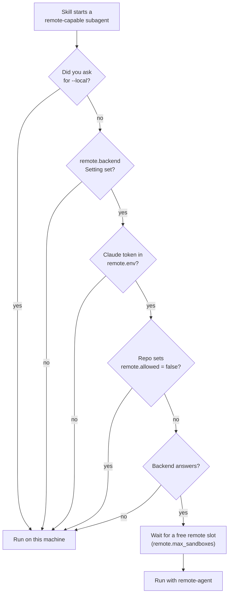
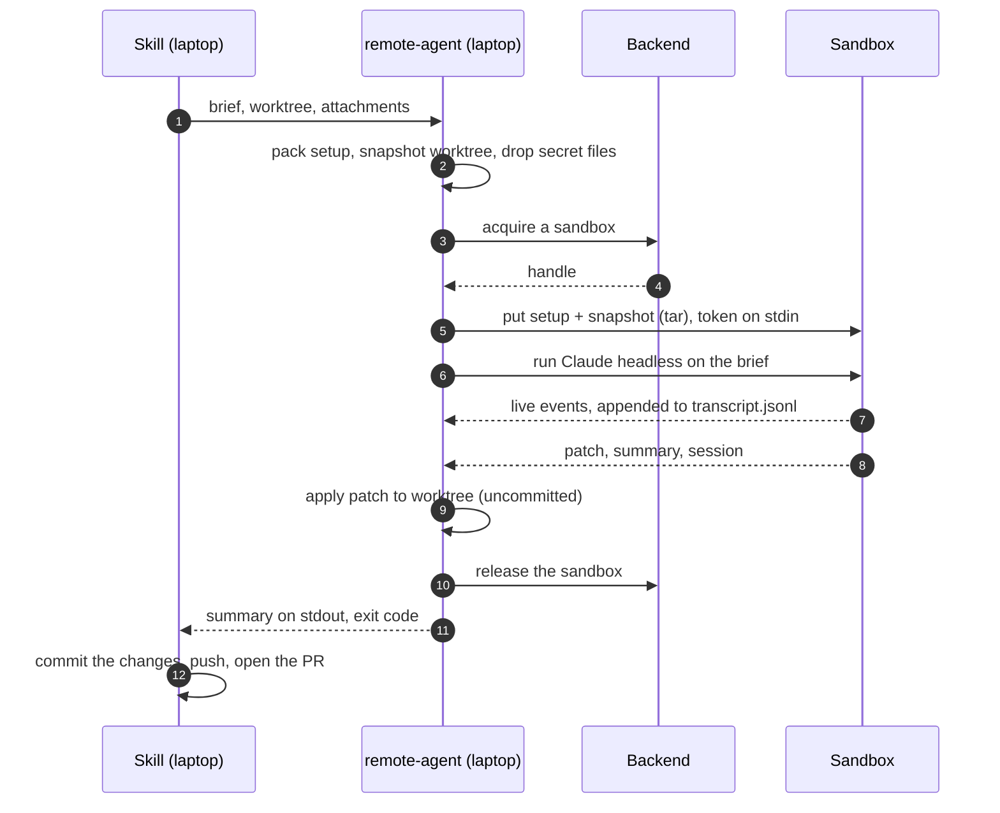
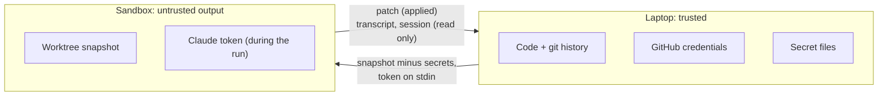

# ☁️ Remote subagents

[← Back to the docs](README.md)

> **TL;DR** Your laptop stays the boss. A remote machine borrows a copy of one worktree, lets Claude work on it, and hands back a patch. No GitHub credentials ever leave your laptop.

Some skills, like `build-epic`, want to run lots of implementers at once. Your laptop's fans will tell you how that goes. Remote subagents move that work to other compute:

- ☸️ a **Kubernetes cluster**,
- 🐳 **Docker** on this machine,
- 🖥️ a **VM or spare PC** over SSH.

The remote side is **compute only**. It gets your setup and a snapshot of one worktree, runs Claude headless on one task, and sends back a patch. The code, the git history, GitHub access and the session in charge all stay on your laptop. Because the sandbox never touches GitHub, this works for any project, even one the remote machine's owners can't access.

Good to know:
- Remote subagents never talk to each other ([why](agent-communication.md)).
- Wondering how this differs from Claude Code's self-hosted environments? See [claude-features.md](claude-features.md).
- Eval cases can run on the same backend ([evals.md](evals.md#remote)).
- This page is the friendly tour. Every flag, file and backend detail is in [remote/README.md](../remote/README.md).

## 🚀 Quick start

Three commands, once per machine:

```sh
~/.agents/bin/remote-agent setup   # pick a backend, fill in its details, paste a token from `claude setup-token`
~/.agents/bin/remote-agent check   # checks everything the backend needs, then a dry run (no API call, no cost)
~/.agents/bin/remote-agent ready   # inside a repo: would skills send its subagents remote? If not, why not
```

When `check` prints `ok`, you're done. Skills now send remote-capable subagents to your backend on their own.

`setup` saves the backend's Settings in `~/.config/dotagents/settings.json`. It saves the Secrets (the Claude token, an SSH password or key passphrase) in `~/.config/dotagents/remote.env`, readable only by you (mode 600). To change your mind later, ask the `configure` skill ("disable remote") or use `~/.agents/bin/settings` ([settings.md](settings.md)).

> 💡 You need the `remote` group installed first: `./install.sh remote`.

## 🎯 Pick your backend

```mermaid
flowchart LR
  laptop["Laptop<br/>remote-agent"]
  subgraph cluster["cluster"]
    pool["Warm pool"] --> pod["Pod per run<br/>(SandboxClaim)"]
  end
  subgraph docker["docker"]
    c1["Container per run<br/>on this machine"]
  end
  subgraph ssh["ssh"]
    c2["Container per run<br/>on the host"]
    bare["bare mode: a folder per run<br/>(weaker isolation)"]
  end
  laptop -- "kubectl exec" --> pod
  laptop -- "docker exec" --> c1
  laptop -- "ssh + docker" --> c2
  laptop -. "ssh" .-> bare
```



| Backend | Each run gets | Pick it when |
|---|---|---|
| ☸️ `cluster` | A pod claimed from a warm pool | You have a cluster: fast starts, many runs at once |
| 🐳 `docker` | A fresh container of the runner image, on this machine | You're trying it out, or want isolation without moving compute |
| 🖥️ `ssh` | A fresh container on the host (default), or a bare folder | You have a spare machine with cores to lend |

All three do the same five things (`acquire`, `put`, `run`, `get`, `release`). Packing, secret filtering, results and exit codes are identical. Only where the sandbox lives changes.

### ☸️ What a cluster needs

The repo ships no cluster manifests, so you set up the cluster side yourself. Here's the checklist.

**On the cluster:**

1. The [agent-sandbox](https://github.com/kubernetes-sigs/agent-sandbox) controller, with its extension CRDs. `remote-agent` creates `SandboxClaim` objects (`extensions.agents.x-k8s.io/v1beta1`).
2. A namespace for the sandboxes. The default is `agents`.
3. A `SandboxTemplate` and a warm pool in that namespace. The template's pod needs:
   - the runner image `ghcr.io/rpvsilva/agent-runner:main` (public, `amd64` and `arm64`), or your own with `sh`, GNU `tar`, `gzip`, `git`, `node` and `claude`;
   - a writable `$HOME` (`/home/node` in the runner image, uid 1000);
   - CPU and memory limits. On a cluster these set each run's size.
4. *Recommended:* a NetworkPolicy that allows internet egress only (Anthropic and package registries) and blocks cluster services and the LAN. Nothing in this repo creates it.

**On your laptop:**

- `kubectl` on your `PATH`.
- A kube context that can create `sandboxclaims` and `pods/exec` in the namespace. `check` tests both with `kubectl auth can-i`. A run also reads claims, sandboxes and pods, and deletes its claim.
- A Claude token from `claude setup-token`.

**Settings** (`setup` asks for them):

| Setting | Default | What it is |
|---|---|---|
| `remote.context` | none, required | The kube context |
| `remote.pool` | none, required | The warm pool to claim from |
| `remote.namespace` | `agents` | Where claims are made |
| `remote.claim_timeout` | 180 | Seconds to wait for a claimed pod to be ready |
| `remote.max_sandboxes` | 4 | Set it to the warm pool's size. A claim on a full pool waits, then fails |

Each pod carries the label `sandbox.users.io/remote-agent-run=<run>`, plus `sandbox.users.io/remote-agent-task=<task>` when the run has a name. So `kubectl get pods -L sandbox.users.io/remote-agent-task` tells runs apart, and `kubectl logs -f <pod>` follows one.

### 🐳 What Docker needs

A running Docker daemon and the runner image. That's it. `check` also tells you when the image's architecture differs from your machine's (it would run emulated, and slowly).

### 🖥️ What SSH needs

An SSH login to the host (a key or a password) and Docker on the host. In **bare mode**, the host needs `bash`, `git`, `jq`, `node` and `claude` instead.

> ⚠️ Use bare mode only on a host you fully trust. There's no container: the run shares the OS user with that user's own setup.

## 🤖 When does a subagent go remote?

Only **remote-capable** subagents can: ones that change nothing but their own worktree. Each is declared once, in the `remote` list of the `needs.json` beside its brief ([remote-subagents](../skills/remote-subagents/SKILL.md) has the details). Before each one starts, the skill runs `remote-agent ready` and walks this tree:



Every "no" falls back gracefully. When remote is off, the skill says why once, then runs subagents locally as usual. A subagent no `remote` list names (a planner, anything that needs GitHub) always runs locally.

## 🔁 The life of one run



1. **📦 Pack.** `remote-agent` gathers your setup: `CLAUDE.md`, skills, agents, the hooks under `~/.agents/hooks`, and a cut-down `settings.json`. It snapshots the worktree's tracked and unignored files, leaving out secret-looking ones by the same rule as the `guard-secrets` hook. Credentials, history and caches never leave the laptop.
2. **🚚 Send.** The backend hands over a fresh sandbox. The setup and snapshot go in as tar streams. The Claude token goes through stdin, never as an argument.
3. **🏃 Run.** The sandbox reinstalls plugins and MCP servers, commits the snapshot as a base, and runs Claude on the brief. Events stream back as they happen.
4. **📬 Return.** The patch lands in your worktree, uncommitted. The skill reviews and commits it, just like a local subagent's work.
5. **🧹 Release.** The sandbox is removed on exit, Ctrl-C or `kill`. If your laptop dies first, the sandbox removes itself after `remote.hours` (2 by default).

### 🛡️ Runaway commands get capped

Every shell command Claude runs in the sandbox goes through `capped`. A runaway test gets killed, and Claude carries on.

- **Memory cap:** the sandbox's memory limit less 1024 MB for Claude (2000 MB when there's no limit). Lower it with `remote.cap_mb`.
- **Time cap:** `remote.cap_secs` (300 seconds).
- A test command that calls `capped` itself with no flags gets the same caps (`CAPPED_MB`, `CAPPED_SECS`).
- A kill adds one stderr line, `[<task>] killed: memory|timeout <command>`, and doesn't change the exit code.

The caps need `python3` and the packed `~/.agents/bin/capped` in the runner image, plus `ps` where there's no `/proc`. On Linux, `capped` reads process groups from `/proc`, so the cluster runner image (which has no `ps`) is still capped. A sandbox missing one of these runs uncapped and says so: `== capped: unavailable (missing: python3)` on stderr and `capped_off` in `result.json`.

### 🚦 Exit codes

| Code | Meaning |
|---|---|
| `0` | The patch was applied |
| `3` | No changes |
| `4` | The patch didn't apply because the worktree changed meanwhile. The patch is kept |

When the sandbox itself vanishes (its container or pod gone, with no kill line before), `result.json` says `lost: true`.

## 🔐 Who trusts whom



- **Never sent:** GitHub credentials, git remotes, secret files, shell history. The sandbox can't push, open a PR or read another branch.
- **Only the patch is applied.** Everything else that comes back (transcript, summary, session) is data to read, never instructions to follow. The Claude token is replaced by `[redacted]` in every kept file.
- **The session isn't resumed for you.** A prompt-injected agent could forge turns in it that would read as yours. `remote-agent resume <run> <worktree>` places it only when you ask, after a warning.
- **Who can peek:** on the cluster, egress goes to the internet only, with cluster services and the LAN blocked. Cluster admins, and anyone who can run `docker` on the host, can see the snapshot and token while a run is alive.

## 🎛️ Settings you'll likely touch

| Setting | Default | Meaning |
|---|---|---|
| `remote.backend` | unset (off) | `cluster`, `docker` or `ssh` |
| `remote.max_sandboxes` | 4 | Most remote runs at once, across all skills. Set it to what the backend holds |
| `remote.allowed` | true | Set it to `false` in a repo to keep its code on this machine |
| `remote.hours` | 2 | How long before an abandoned sandbox removes itself |
| `remote.cap_mb` | unset | A lower memory cap, in MB, for each shell command in the sandbox |
| `remote.cap_secs` | 300 | Time cap, in seconds, for each shell command in the sandbox |
| `remote.sandbox_mb`, `remote.sandbox_cpus` | unset | `docker` and `ssh` (container mode): each run's memory (MB) and CPU limits, its share of a host others may use too. Unset: the host's total over `remote.max_sandboxes`. On a cluster, the SandboxTemplate's pod limits decide |

The full list, with each backend's own Settings, is in [remote/settings.json](../remote/settings.json).

## 👀 Watching a run

> 💡 In Claude Code, the `agent-flow` mod does this for you. Install it with `./install.sh claude remote agent-flow`, then open `/agent-flow`. It shows each run under the agent that started it, lists runs from other sessions in its Agents tab, and notifies you when one ends.

By hand, each run keeps a folder at `<common git dir>/remote-agent/<run>/`. Find the common git dir with `git rev-parse --path-format=absolute --git-common-dir`. It sits outside the worktree, so removing a worktree keeps its runs' records. (Runs from before records moved there sit in `<common git dir>/worktrees/<name>/remote-agent/<run>/`. They aren't moved and go with their worktree, though `remote-agent resume` still finds them while it's there.)

| File | Holds |
|---|---|
| `transcript.jsonl` | The agent's events as they arrive. Follow along with `tail -f` |
| `run.json` | State (`starting`, `running`, `done`, `failed`), timings, exit code |
| `progress.log` | One line per step, the same as stderr |
| `result.json` | **The outcome. Read this, not stdout.** Exit code, `status`, the agent's own `report_status`, changed files, turns, tokens, cost, model, `claude_version`, `complete`, the `caps` set, `capped_off`, `capped_kills`, `killed` and `lost` |
| `capped.log` | Each command the caps killed |
| `changes.patch`, `summary.md` | What came back: the patch, and the agent's final message (its JSON output object) |
| `session.jsonl` | Claude's session, for `remote-agent resume` |

Handy commands, run inside the repo:

```sh
remote-agent result <name|run>               # print a run's result.json
remote-agent prune --older-than 30d --dry-run  # see which old run folders would go
remote-agent prune --older-than 30d          # then clear them
```

- **`result`** takes a run id, or a `--name` given at start. For a name, it picks the newest run with that name (a retry reuses the name), preferring runs started from your own worktree. It works for runs started together, in a loop, or with stderr redirected. It exits 1 with one line when nothing matches or the newest run hasn't ended.
- **`prune`** takes `Nd` or `Nh` (at most 999999). It removes run folders, in both locations, whose `run.json` `ended` time (else `started`, else the folder's last change) is older than that, one line per folder, then the count. A live run is always kept. A run marked running whose process is gone is stopped, then removed. Runs never delete records on their own.
